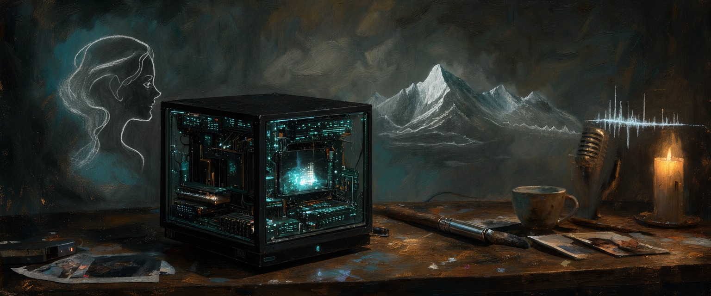

# SparkStack



**Ship intelligence in a 128 GB box — for fun and profit.** A complete private AI
server for the **NVIDIA DGX Spark**. The Spark is the server; everything else on
your LAN — agents, apps, other machines — are its clients:

| Port | Endpoint | Serves | Guide |
|---|---|---|---|
| `:9193` | `POST /v1/chat/completions` | 27B chat + vision | [chat](docs/chat-api.md) |
| `:9194` | `POST /v1/systemone` | one-shot decisions (yes/no/score) | [decisions](docs/decisions-api.md) |
| `:9195` | `POST /v1/embeddings` | text/image/video/audio embeddings | [embeddings](docs/embeddings-api.md) |
| `:9198` | `POST /v1/rerank` | cross-encoder reranking | [reranking](docs/reranking-api.md) |
| `:9196` | `POST /v1/images/generations` | FLUX.3 image generation + editing | [images](docs/image-api.md) |
| `:9191` | `POST /transcribe` | speech-to-text | [speech-to-text](docs/speech-to-text-api.md) |
| `:9192` | `POST /v1/audio/speech` | text-to-speech, 10 voices | [text-to-speech](docs/text-to-speech-api.md) |
| `:9190` | browser | status dashboard | [monitoring](docs/metrics.md) |
| `:9197` | browser | container logs | — |
| `:9199` | browser | Prometheus metrics | [metrics](docs/metrics.md) |
| `:9200` | browser | Grafana dashboards | [metrics](docs/metrics.md) |

Prefix any endpoint with your Spark's LAN address. `./sparkstack.sh server`
prints the full map anytime. Set a static DHCP lease so the address never
surprises you.

What you get: **chat with vision, a decision model, a reranker, multimodal
embeddings, image generation, speech-to-text and text-to-speech** behind one LAN
address, with Prometheus metrics and Grafana dashboards. Your own AI backend with
no API bills, no rate limits and no data leaving your LAN — for private coding
agents, RAG over your own documents and media, local voice assistants, batch
image generation and routing inside agent loops.

**Everything runs at once.** The chat model is coder390, a Qwen3.8-27B post-train
in NVFP4 W4A16 with text and image input. SGLang serves it with DFlash2
speculative decoding, the full 262K context and tool calling. Decisions,
embeddings and reranking run on llama.cpp; images on stable-diffusion.cpp. The
whole stack fits in the Spark's 128 GB unified memory with roughly 17 GiB to
spare at idle.

## Install (on the Spark)

Needs Docker + Compose v2, git and curl, plus ~110 GB free disk (41 GB of models,
the rest Docker images). `install` checks the tooling and installs `uv` if needed.

1. Clone and configure:

   ```bash
   git clone https://github.com/malvavisc0/SparkStack.git && cd SparkStack
   cp .env.example .env    # put your Hugging Face token and LLM_API_KEY in .env
   ```

   (Token: huggingface.co → Settings → Access Tokens.)

2. **Accept the FLUX.3 license** with that same account at
   <https://huggingface.co/black-forest-labs/flux-3-image-klein> — required for
   the VAE (`ae.safetensors`). Approval is instant; without it `install` fails on
   the image model download.

3. Install:

   ```bash
   ./sparkstack.sh install
   ```

`install` downloads the models (~41 GB), builds the llama.cpp and
stable-diffusion.cpp images for the GB10 GPU, pulls the SGLang image, starts
everything and prints the endpoint map. Once it finishes, open `http://spark:9190`
— all cards green means healthy. Replace `spark` with the LAN address printed by
`./sparkstack.sh server`. After the first `install` or `up`, run
`./sparkstack.sh test`: it waits for each service to finish loading, then fires a
real request per endpoint and prints the evidence. The first request on every
service pays lazy-init costs (CUDA graphs, JIT kernels); `test` absorbs those so
real traffic starts warm.

All services are up after install — chat, images, speech, embeddings, decisions,
status and logs, simultaneously. `up` starts everything by default; `down` stops
it.

## Try it

Replace `spark` with your Spark's LAN hostname or IP; `./sparkstack.sh server`
prints it.

```bash
curl http://spark:9193/v1/chat/completions \
  -H "Authorization: Bearer $LLM_API_KEY" \
  -H 'Content-Type: application/json' \
  -d '{
    "model": "coder390",
    "messages": [{"role": "user", "content": "Explain unified memory in one paragraph."}]
  }'
```

Every endpoint has a request guide with curl examples, response shapes, measured
timings and a standard-library Python client: [docs/README.md](docs/README.md).

## Models

~41 GB of weights, quantized for the 128 GB budget. Every service's model and
source repository, with the full license and per-file breakdown, is in
[models.md](docs/models.md).

| Service | Models | Footprint | Source |
|---|---|---|---|
| Chat + vision | Coder390 27B NVFP4 W4A16 + DFlash2-FP8 draft | ~22 GB | [Coder390](https://huggingface.co/nerkyor/Qwen3.8-27B-Coder390-EfficientThink-Opus5.5-GPT6Astra-Grok4.7-DSV4Pro-K3-SFT-RLOO-MTP-DFlash2) |
| Decisions | d1-2B Q8_0 + mmproj | ~2.0 GB | [d1-2B](https://huggingface.co/LiquidAI/d1-2B-GGUF) |
| Embeddings | EmbeddingGemma 2 Q8_0 + mmproj | ~825 MB | [EmbeddingGemma 2](https://huggingface.co/unsloth/embeddinggemma-2-GGUF) |
| Reranking | Qwen3-Reranker-0.6B Q8_0 | ~610 MB | [Qwen3-Reranker](https://huggingface.co/Voodisss/Qwen3-Reranker-0.6B-GGUF-llama_cpp) |
| Images | FLUX.3 Image Klein Q8_0 + Qwen3-VL-4B text encoder + VAE | ~11 GB | [FLUX.3](https://huggingface.co/unsloth/flux-3-image-klein-GGUF) · [Qwen3-VL](https://huggingface.co/Qwen/Qwen3-VL-4B-Instruct-GGUF) · [VAE](https://huggingface.co/black-forest-labs/flux-3-image-klein) |
| Speech-to-text | Whisper large-v3 + pyannote speaker-diarization-3.1 | ~3 GB | [Whisper](https://huggingface.co/Systran/faster-whisper-large-v3) · [pyannote](https://huggingface.co/pyannote/speaker-diarization-3.1) |
| Text-to-speech | Qwen3-TTS-12Hz-1.7B-VoiceDesign | ~4.3 GB | [Qwen3-TTS](https://huggingface.co/Qwen/Qwen3-TTS-12Hz-1.7B-VoiceDesign) |
| Hires upscaler (optional) | RealESRGAN_x4 | 64 MB | [Real-ESRGAN](https://huggingface.co/ai-forever/Real-ESRGAN) |

FLUX.3 and pyannote are gated: accept their terms with the same HF account as
`HF_TOKEN`. WhisperX downloads language-specific alignment models into
`data/whisper-data` on demand. Optional LoRAs and upscalers go in
`models/flux3/loras/` and `models/flux3/upscalers/`.

## Operate

| Command | What it does |
|---|---|
| `./sparkstack.sh up [profiles]` | start services (default: the whole stack) |
| `./sparkstack.sh down` | stop the stack |
| `./sparkstack.sh test` | wait for loads, fire a real request per endpoint, print the evidence |
| `./sparkstack.sh update` | rebuild images, restart what was running |
| `./sparkstack.sh logs <service>` | follow one service's logs |
| `./sparkstack.sh server` | print the LAN address and endpoint map |

Full command list, profiles, startup and cache behavior, watchdog setup and
troubleshooting: [operations.md](docs/operations.md).

## Security

The chat API requires `LLM_API_KEY`; everything else is unauthenticated. This
stack is built for a trusted private LAN, not the public internet: Dozzle can
control Docker, Grafana allows anonymous viewing, and the 919x block should not
be port-forwarded. Read [security.md](docs/security.md) before exposing anything.

## Documentation

- [Service guides](docs/README.md) — per-endpoint request shapes, clients and timings
- [Models and hardware](docs/models.md) — full model table, licenses, footprint and storage
- [Operations](docs/operations.md) — commands, profiles, caches, watchdog, troubleshooting
- [Security](docs/security.md) — exposure, authentication and trust boundaries
- [Metrics](docs/metrics.md) — Prometheus, Grafana, node-exporter and the GPU collector

## License

MIT. See [LICENSE](LICENSE).
